  

  <b>박태정 · TAEPAPER</b> 
  LLM · RAG · 모델 서빙 · 백엔드를 만들고 있어요. 
  작은 변화가 쌓여 확 꺾이는 순간 — <b>tipping point</b>를 향해 갑니다. 🎯

---

### 🛠 What I work on

- **LLM / RAG** — 검색 증강 생성과 에이전트 시스템 설계
- **Model Serving** — Triton Inference Server로 모델 서빙 인프라 구축
- **Infra** — Kubernetes 기반 운영, 실시간 영상 파이프라인
- **Backend** — Java Spring 서버 개발

### 🧰 Tech Stack

  
  
  
  
  
  
   
  
  
  
  
  

### 📌 Projects

| Project | 설명 | Stack |
|---|---|---|
| [**photo_search**](https://github.com/TAEPAPER/photo_search) | 자연어로 내 사진첩을 검색하는 멀티모달 검색 | CLIP · Qdrant · FastAPI · Streamlit |
| [**webhook_debugger**](https://github.com/TAEPAPER/webhook_debugger) | 들어오는 HTTP 요청을 실시간으로 보여주는 셀프호스팅 웹훅 디버거 | Java · Spring · WebSocket · Docker |
| [**displaydog**](https://github.com/TAEPAPER/displaydog) | 화면 위를 걸어 다니는 강아지 친구, macOS 앱 | Swift · Firebase |

### 🐾 My Farm

